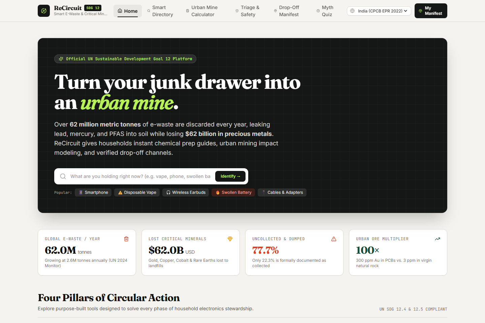
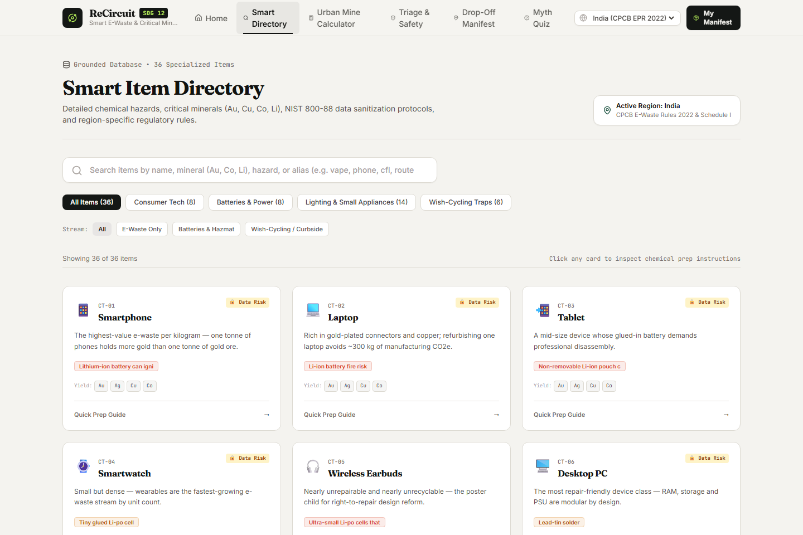
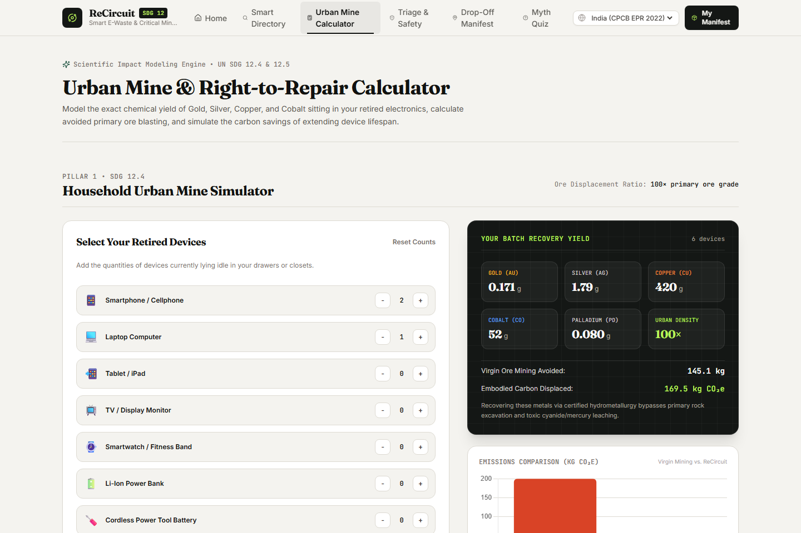
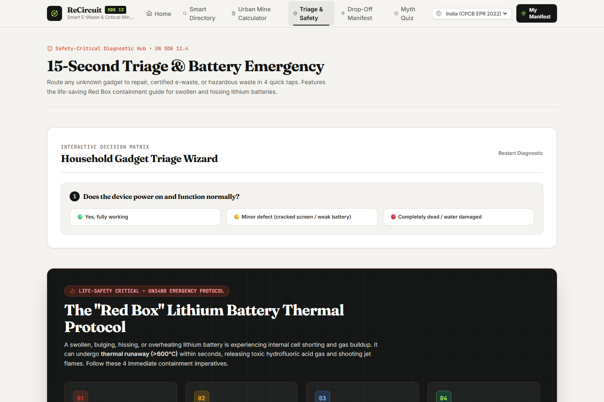

# ReCircuit — Smart E-Waste & Critical Mineral Recovery (UN SDG 12)

> **Turn your junk drawer into an urban mine. Know where every device, battery, and tricky item belongs — in seconds.**

ReCircuit is an open-source, client-side circular intelligence platform aligned with **United Nations Sustainable Development Goal 12 (Responsible Consumption and Production)**:
- **Target 12.4:** Environmentally sound management of hazardous wastes and toxic chemicals throughout their life cycle.
- **Target 12.5:** Substantially reduce waste generation through prevention, reduction, repair, reuse, and recycling by 2030.

---

## 📸 Project Interface & Screenshots

### 1. UN SDG 12 Hub & Real-Time E-Waste Ticker (`index.html`)
Live global indicators tracking 62M tonnes of annual e-waste, $62B in lost critical minerals, and a 100× urban ore concentration multiplier.


### 2. Smart Item Directory with 36+ Specialized Recyclables (`lookup.html`)
Complete chemical hazards, recoverable critical minerals (Au, Ag, Cu, Co, Li, Nd), NIST SP 800-88 data sanitization checklists, and regional law tags (CPCB 2022, EPA RCRA, EU WEEE).


### 3. Urban Mine & Right-to-Repair Impact Engine (`calculator.html`)
Scientific mathematical calculators quantifying precious metals yield, avoided primary ore blasting, and net carbon avoided through lifespan extension.


### 4. 15-Second Triage & Red Box Battery Thermal Protocol (`triage.html`)
A rapid 4-step diagnostic wizard paired with life-safety containment protocols for swollen, bulging, and hissing lithium-ion batteries.


---

## 🌍 The Global Crisis: Why ReCircuit Exists

Global electronic waste is growing 5× faster than documented formal recycling:
- **62 million metric tonnes (Mt)** of e-waste was generated globally in 2022 (7.8 kg per capita), rising to **65 Mt in 2023** and projected to exceed **82 Mt by 2030** ([UN Global E-Waste Monitor 2024](https://ewastemonitor.info/the-global-e-waste-monitor-2024/)).
- Only **22.3%** was formally documented as collected and environmentally managed ([WHO](https://www.who.int/news-room/fact-sheets/detail/electronic-waste-(e-waste))).
- **$62 to $91 billion USD** worth of critical raw materials (including Gold, Silver, Copper, Cobalt, and Rare Earth Elements) are lost directly to municipal landfills.
- **240+ documented waste truck & recycling facility fires** are sparked annually by improperly discarded lithium-ion batteries crushed in compactor trucks ([US EPA](https://www.epa.gov/recycle/used-lithium-ion-batteries)).

Most green applications are static informational brochures. **ReCircuit** provides an actionable, multi-page platform that models materials recovery, enforces safety containment, and routes items to verified recyclers.

---

## ⚡ Multi-Page Architecture & Core Pillars

ReCircuit is architected into 6 modular, dedicated pages:

1. **Mission Hub (`index.html`)**:
   - Hero search with auto-suggestions, global e-waste ticker, 4-pillar navigation gateway, and metallurgical comparison data.
2. **Smart Item Directory (`lookup.html`)**:
   - 36+ grounded items across Consumer Tech, Batteries & Power, Lighting & Small Appliances, and Wish-Cycling Traps.
   - Real-time search, category filtering, stream isolation (E-Waste, Battery, Curbside, Household).
   - Interactive Modal Drawer with step-by-step chemical prep instructions, CISA NIST 800-88 data wiping guidelines, and 1-click "Add to Manifest".
3. **Urban Mine & Repair Calculator (`calculator.html`)**:
   - **Urban Mine Estimator**: Interactive household device inventory computing recovered Gold, Silver, Copper, Cobalt, and Palladium, avoided virgin ore excavation, and embodied carbon avoided.
   - **Right-to-Repair Lifespan Simulator (SDG 12.5)**: Interactive slider model computing net carbon avoided ($\text{kg CO}_2\text{e}$) and consumer financial savings by replacing batteries and screens instead of buying new.
4. **15-Second Triage & Thermal Safety (`triage.html`)**:
   - 4-question decision matrix routing unknown items to donate, repair, battery-tape, or hazardous collection.
   - **"Red Box" Lithium Battery Thermal Runaway Protocol**: Step-by-step containment instructions for swollen and hissing batteries (terminal taping, non-combustible sand container, 10m outdoor perimeter).
5. **Drop-Off Manifest & Centers Locator (`dropoff.html`)**:
   - Dynamic collection box manifest persisted across sessions via `localStorage`.
   - Physical prep safety checklist.
   - 1-Click "Copy Manifest" and 1-Click "Print Label" for drop-off boxes.
   - Verified Recycler Directory: Filterable across India (CPCB 2022 authorized dismantlers), USA (EPA R2/e-Stewards, Call2Recycle), and Global/EU (WEEE collection hubs).
6. **Wish-Cycling Myth-Buster Quiz (`quiz.html`)**:
   - 6 scenario-based questions dispelling common recycling mistakes (vapes in blue bins, greasy pizza boxes, broken CRTs, quick format data risks).
   - Generates UN SDG 12 Eco-Champion badges.

---

## 📐 Scientific & Mathematical Foundations

### 1. Urban Mine Mineral Recovery Index (MRI)
$$M_k = \sum_{i} Q_i \cdot m_i \cdot c_{i,k} \cdot \eta_k$$
- $Q_i$: Quantity of device category $i$.
- $m_i$: Average device mass (kg).
- $c_{i,k}$: Concentration of critical mineral $k$ (g/kg).
- $\eta_k$: Metallurgical recovery yield factor ($\approx 0.90\text{--}0.95$ for hydrometallurgical refining).

### 2. Avoided Virgin Ore Mining Excavation
$$\text{Ore}_{\text{avoided}} = \sum_{k} M_k \cdot \text{OreGradeFactor}_k$$
- Primary gold ore contains only **1 to 5 ppm** of gold (extracting 1 kg of gold requires blasting ~333 tonnes of natural rock).
- Recycled smartphone circuit boards hold **~300 to 350 ppm** of gold — a **100× higher concentration than natural rock**.

### 3. Embodied Carbon Displacement
$$\Delta \text{CO}_{2,\text{avoided}} = \sum_{k} M_k \cdot \left(\epsilon_{\text{virgin}, k} - \epsilon_{\text{recycled}, k}\right)$$
- Virgin gold mining emits ~18,000 kg CO₂e per kg of metal.
- Secondary e-waste refining emits ~800 kg CO₂e per kg of metal — displacing **17,200 kg CO₂e per kg of recovered gold**.

### 4. Right-to-Repair Lifespan Extension Carbon Model (SDG 12.5)
$$\Delta \text{C}_{\text{repair}} = E_{\text{mfg}} \cdot \left(1 - \frac{L_{\text{baseline}}}{L_{\text{extended}}}\right) - E_{\text{repair}}$$
- Over 80% of a smartphone's lifetime carbon footprint is locked in manufacturing ($E_{\text{mfg}} \approx 85\text{ kg CO}_2\text{e}$).
- Extending a smartphone's lifespan from 2.5 to 4.5 years via a battery swap ($E_{\text{repair}} \approx 3\text{ kg CO}_2\text{e}$) saves **34.7 kg CO₂e** — 4× greater than the carbon saved by recycling it prematurely.

---

## 🛠️ Technology Stack & Resilience

- **Architecture:** Zero-build, 100% client-side HTML5, CSS3, JavaScript (ES6+).
- **Styling:** Tailwind CSS CDN (v3.4.17) + Editorial typography (Fraunces serif, Inter, JetBrains Mono) + Warm paper `#F4F3EF` & Obsidian `#141715` aesthetic.
- **Icons & Data Viz:** Lucide Icons (v0.460.0), Chart.js (v4.4.1).
- **Persistence:** Client-side `localStorage` state management for manifests and regional preferences.
- **No Node/npm Build Required:** Runs natively in any modern browser without bundlers or server-side dependencies.

---

## 🚀 Quick Start & Local Run

Clone the repository and serve with any local HTTP server:

```bash
# Clone the repository
git clone https://github.com/naman-swami/ReCircuit-Smart-E-Waste-Household-Recycling-Guide-UN-SDG-12-.git
cd ReCircuit-Smart-E-Waste-Household-Recycling-Guide-UN-SDG-12-

# Serve with Python (built-in)
python -m http.server 8080
```

Open your browser at `http://localhost:8080/index.html`.

---

## 📜 Regulatory Standards & Sources

- **United Nations:** [UN Sustainable Development Goal 12](https://sdgs.un.org/goals/goal12) | [Global E-Waste Monitor 2024 (UNITAR / ITU)](https://ewastemonitor.info/)
- **India:** [Central Pollution Control Board (CPCB) E-Waste Management Rules, 2022](https://eprewaste.cpcb.gov.in/)
- **USA:** [US EPA Resource Conservation and Recovery Act (RCRA)](https://www.epa.gov/rcra) | [Universal Waste Regulations](https://www.epa.gov/hw/universal-waste)
- **European Union:** [Directive 2012/19/EU on Waste Electrical and Electronic Equipment (WEEE)](https://environment.ec.europa.eu/topics/waste-and-recycling/waste-electrical-and-electronic-equipment-weee_en)
- **Data Security:** [NIST Special Publication 800-88 Revision 1: Guidelines for Media Sanitization](https://nvlpubs.nist.gov/nistpubs/SpecialPublications/NIST.SP.800-88r1.pdf)
- **Transport Safety:** [UN Manual of Tests and Criteria (Section 38.3: Lithium Batteries)](https://unece.org/transport/dangerous-goods)

---

## 📄 License

This project is licensed under the [MIT License](LICENSE).
